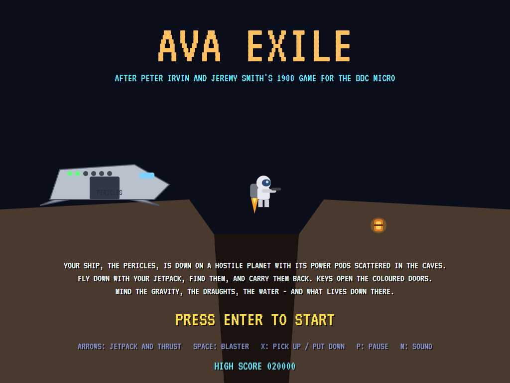
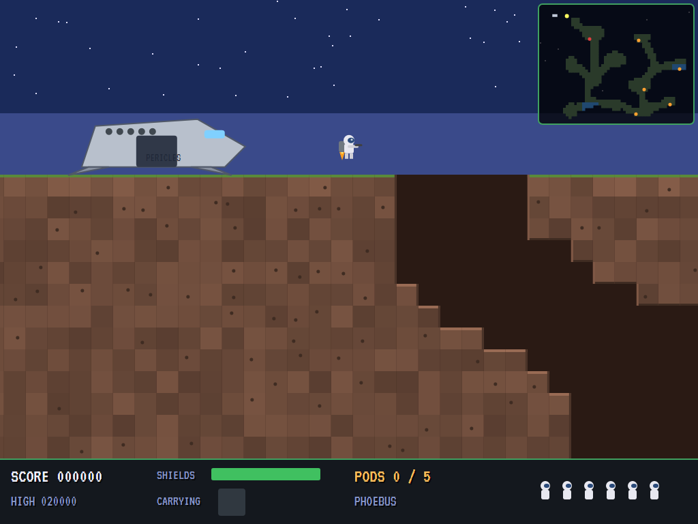
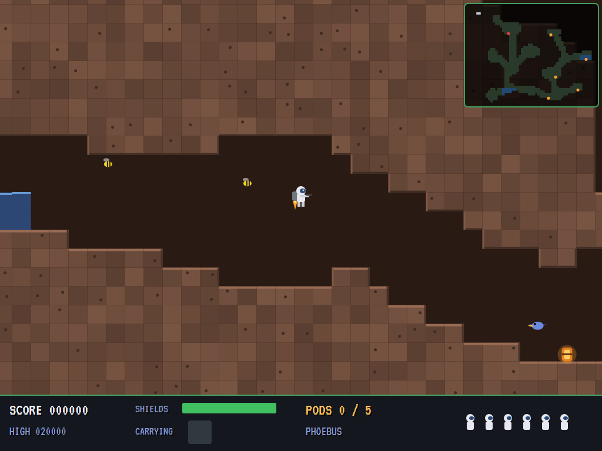
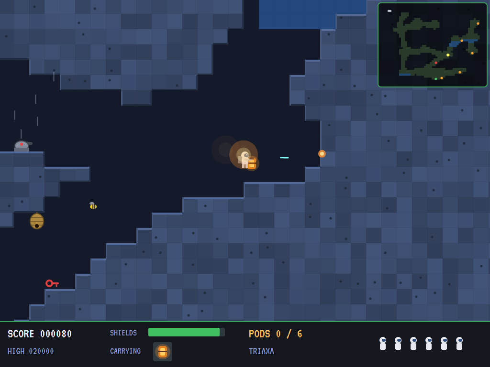
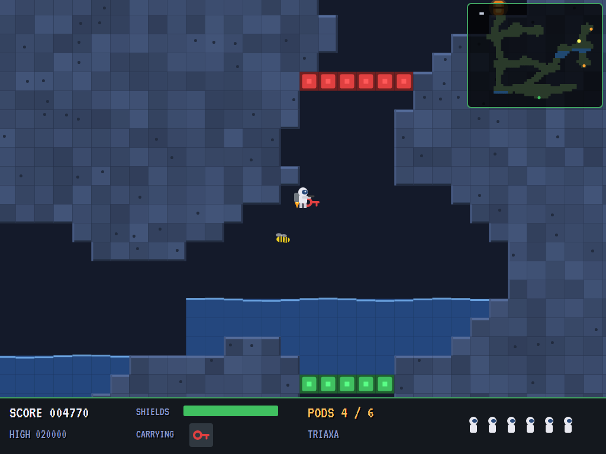
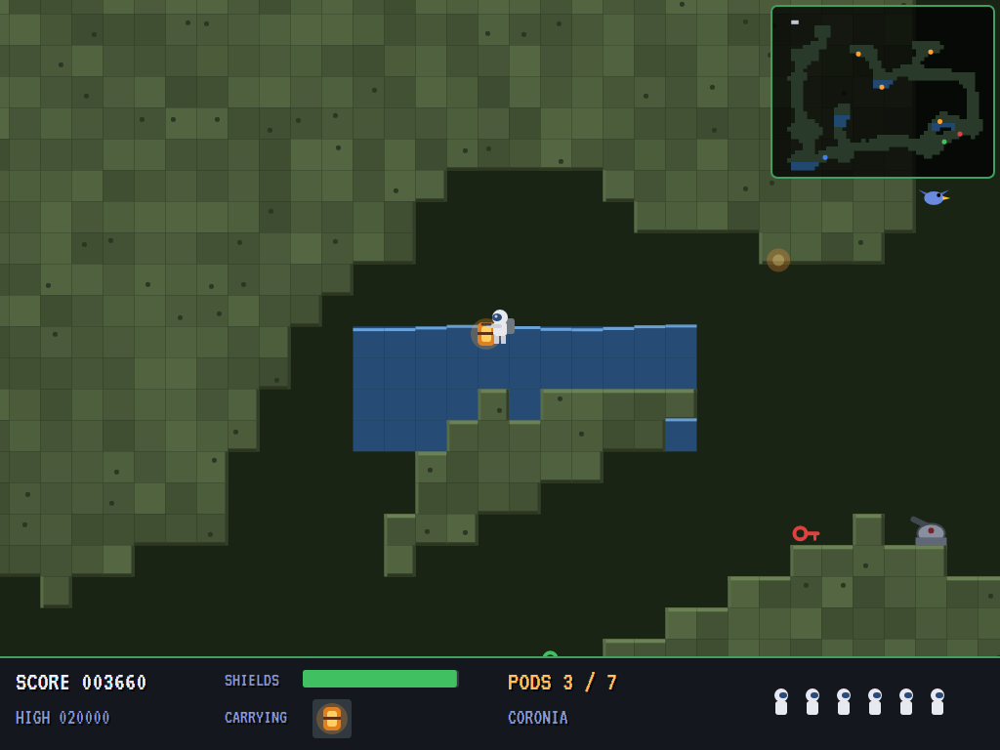
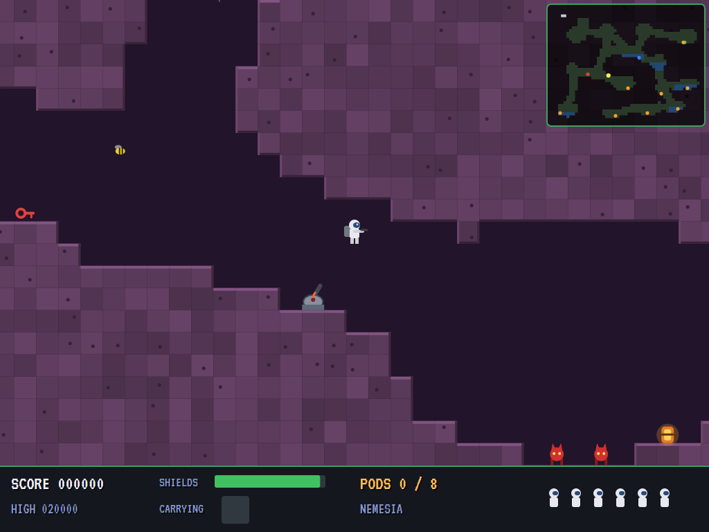
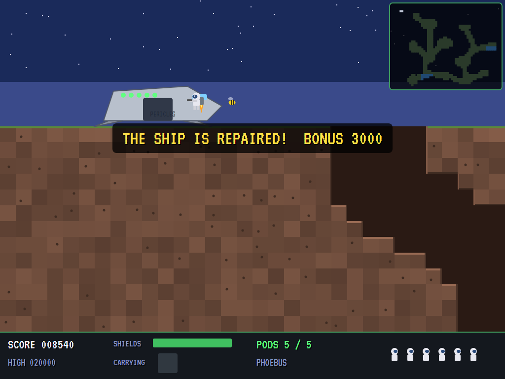
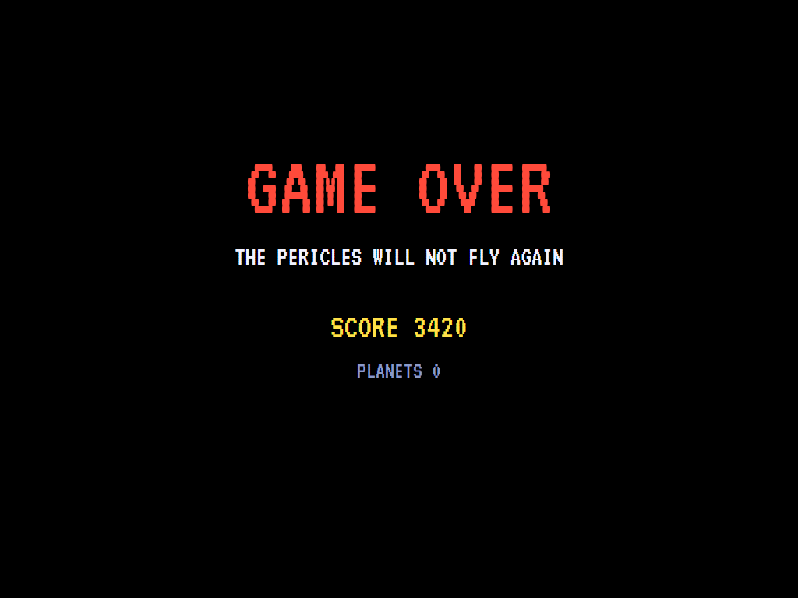
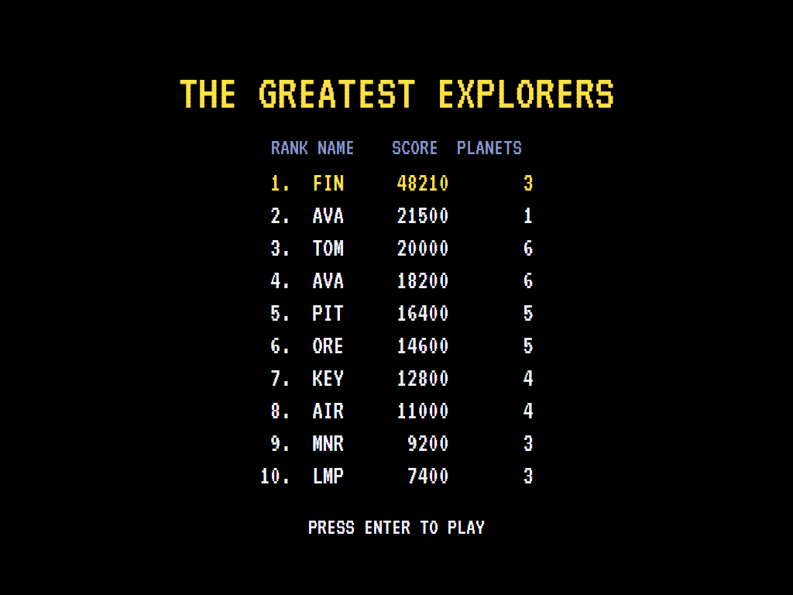

# AVA Exile

[](https://github.com/Harlock123/AVAExile/actions/workflows/build.yml)

A jetpack cave explorer in the style of Peter Irvin and Jeremy Smith's 1988 BBC Micro game **Exile**,
built with .NET 10 and Avalonia UI. Your ship, the Pericles, is down on a hostile planet with its power
pods scattered through the caves below. Fly down on your jetpack, find the pods and carry them back. Gravity,
momentum, draughts and water are against you, and so is everything that lives down there.

## Features

- **Physics:** the jetpack fights gravity, and momentum carries you on after you let go. Left and right
  push you, and drag slows you. Hit rock hard and it hurts. Water slows everything and weakens the jetpack.
  Draughts blow along some passages and up others. A pod is heavy to lift.
- **Four planets of caves:** Phoebus, Triaxa, Coronia and Nemesia. Each has chambers joined by winding
  passages, a shaft down from the surface beside the ship, pools in some chamber floors, and draughts. Each
  has more pods to find, more doors in the way, and more creatures.
- **Coloured doors** across the passages to the furthest pods. Each door's key lies somewhere that can be
  reached without it (or with the doors before it open). Carry the key up to its door and it opens.
- **Carrying:** pick up one thing at a time, and put it down again. Pods go into the ship when you carry
  them to it. Killed, you drop what you held where you fell.
- **Creatures:** birds that wander and then come for you, wasps sent out by the nests hanging from cave
  roofs, imps that run along the floors and leap, and gun turrets that fire when they can see you. Your
  blaster fires the way you face.
- **Shields** soak up harm and build back up slowly. The **scanner** maps the whole cave system: the
  water, the pods, the keys, the ship and you.
- **The attract mode** shows the computer explorer at work. It finds its way square by square to the
  nearest pod it can reach (or the key that opens the way). It flies toward the furthest point of the
  route it can see, firing the jetpack against gravity to hold the speed it wants, and shoots what comes at
  it.

## Screenshots

| The title | The surface | Down in the caves |
|:---------:|:-----------:|:-----------------:|
|  |  |  |
| The Pericles, down. | Jetpack on, off the ground. | Deep under Phoebus. |

| A pod | A key and its door | Water |
|:-----:|:------------------:|:-----:|
|  |  |  |
| Carried back up. | The red key for the red door. | Slow going. |

| Creatures | Repaired | Game over |
|:---------:|:--------:|:---------:|
|  |  |  |
| The blaster at work. | Every pod in. | The Pericles stays down. |



The screenshots are made by the tests, which play the game in a real (headless) window; see
[Tests](#tests).

## Download and run

Ready-to-run builds for Windows, macOS and Linux, on both Intel/AMD and ARM, are on the
[Releases page](https://github.com/Harlock123/AVAExile/releases/tag/latest). **Latest build** is
rebuilt on every push to `main`. Each download is one self-contained executable: no .NET install is
needed.

| Platform | Archive |
|---|---|
| Windows | `AVAExile-win-x64.zip`, `AVAExile-win-x86.zip`, `AVAExile-win-arm64.zip` |
| macOS | `AVAExile-osx-arm64.tar.gz` (Apple silicon), `AVAExile-osx-x64.tar.gz` (Intel) |
| Linux | `AVAExile-linux-x64.tar.gz`, `AVAExile-linux-arm64.tar.gz`, `AVAExile-linux-arm.tar.gz` |

```bash
tar -xzf AVAExile-linux-x64.tar.gz     # or linux-arm64, linux-arm, osx-arm64, osx-x64
./AVAExile
```

On Windows, unzip and run `AVAExile.exe`. On macOS, if Gatekeeper refuses to open it, run
`xattr -d com.apple.quarantine AVAExile` once. Run with `--no-audio` for silence.

**Sound** comes through OpenAL Soft, built in for every platform. In a virtual machine the game
detects it and uses a larger audio buffer, so the sound doesn't break up.

**Gamepads** use SDL2, which is bundled for Windows, macOS and Intel/AMD Linux. ARM Linux builds need it
installed; without it the keyboard still works:

```bash
sudo apt install libsdl2-dev            # Debian / Ubuntu / Raspberry Pi OS
sudo pacman -S --needed sdl2-compat     # Arch / Omarchy
```

## Controls

| Action | Keyboard | Gamepad |
|---|---|---|
| Start | Enter or 1 | Start |
| Jetpack (up) | Up or W | Up |
| Thrust left / right (and face that way) | Left/right or A/D | Left stick / D-pad |
| Push down | Down or S | Down |
| Fire the blaster | Space, Z or Ctrl | A or right trigger |
| Pick up / put down | X or Shift | B or X |
| Pause | P or Esc | Start or Back |
| Sound on/off | M | |
| Screenshot | Ctrl+S (to your Pictures folder) | |

On the high-score table, type your initials, or use up/down and Space, then Enter.

## Tests

```bash
dotnet test AVAExile.slnx
```

The game runs in fixed 60 Hz steps, so it plays the same at any frame rate. Everything that moves lives in
one world that can be copied. The tests check:

- **The caves:** every pod reachable with the doors open, each door's key reachable with the doors before
  it open, and the right number of pods and doors; more on each planet, with draughts, water and at least
  three kinds of creature. The computer explorer repairs every ship, losing no more than two lives.
  Flying about aimlessly brings nothing back.
- **The jetpack:** falling without it and landing; lifting, with momentum after letting go; left and right
  pushing and turning him, and drag slowing him; rock stopping him, and a hard knock hurting; water
  slowing everything, and a draught blowing him along.
- **Carrying:** picking up a pod, carrying it and putting it down (it falls to the floor); a pod's weight;
  a key opening its door and used up; a pod carried to the ship going in.
- **The creatures:** the blaster firing the way he faces and killing a bird; a turret firing when it can see
  him; a nest sending out wasps that sting; shields running out, and what he carried dropped; shields
  building back up.
- **The game:** every pod in, and on to the next planet; killed, and back beside the ship; the last life,
  and the high-score table; the demonstration; pause; the keys, through to the explorer.

`tests/AVAExile.Tests/PilotProbe.cs` reports how the computer explorer gets on on each planet, for tuning
(`EXILE_PROBE=1`; `EXILE_PROBE=lazy` for an explorer who just flies about firing).

The screenshot tests draw the real screen in a headless window. To refresh the README's pictures:

```bash
EXILE_SHOTS=$PWD/Images dotnet test tests/AVAExile.Tests --filter ScreenshotTests
```

## Building

```bash
dotnet build AVAExile.slnx
dotnet run --project src/AVAExile
```

Needs the .NET 10 SDK. The sounds and tunes are made by `tools/make_sounds.py` (standard-library Python):
`python3 tools/make_sounds.py` rewrites `src/AVAExile/Sounds`.

## Project structure

```
AVAExile/
├── AVAExile.slnx
├── src/AVAExile/
│   ├── Engine/
│   │   ├── GameEngine.cs        # States, lives, planets in turn, the title and demonstration
│   │   ├── Sim.cs               # The caves step by step: the jetpack, carrying, doors, pods, creatures, bolts
│   │   ├── World.cs             # Everything that moves or changes, kept together so it can be copied
│   │   ├── Caves.cs             # How the caves are carved, flooded, doored and stocked; the planets
│   │   ├── Pilot.cs             # The computer explorer (the demonstration, and the tests)
│   │   ├── HighScoreTable.cs, InitialsEntry.cs
│   │   ├── InputHandler.cs, ControllerManager.cs  # Keys and an SDL2 gamepad
│   │   └── SoundManager.cs      # Effects and tunes through OpenAL
│   ├── Audio/                   # The OpenAL engine (from the author's AVABand)
│   ├── Views/                   # The drawing: rock, water, draughts, the ship, creatures, the scanner
│   └── Sounds/                  # The synthesised effects and tunes
├── tests/AVAExile.Tests/        # Cave, gameplay and screenshot tests
├── tools/make_sounds.py
└── Images/                      # Screenshots
```

## About and licence

AVA Exile © 2026 Lonnie Watson, under the [MIT License](LICENSE).

*Exile* © 1988 Peter Irvin and Jeremy Smith (published by Superior Software); the names *Exile* and
*Pericles* belong to their current owners. AVA Exile is an independent, unofficial game in its style. Its
planets, caves, graphics, sounds and code are its own; nothing is taken from the original game's program,
graphics or sound. It is not affiliated with or endorsed by any rights holder.
